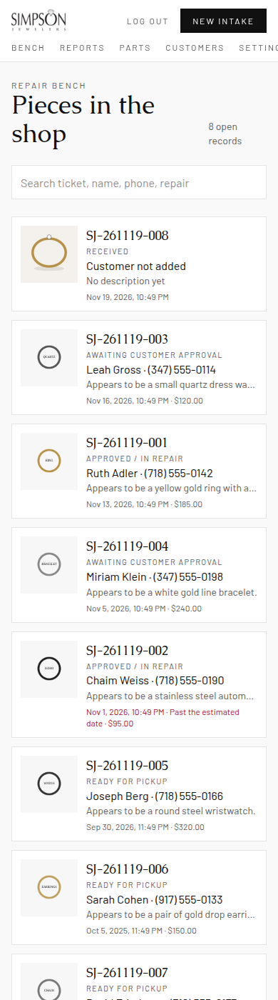
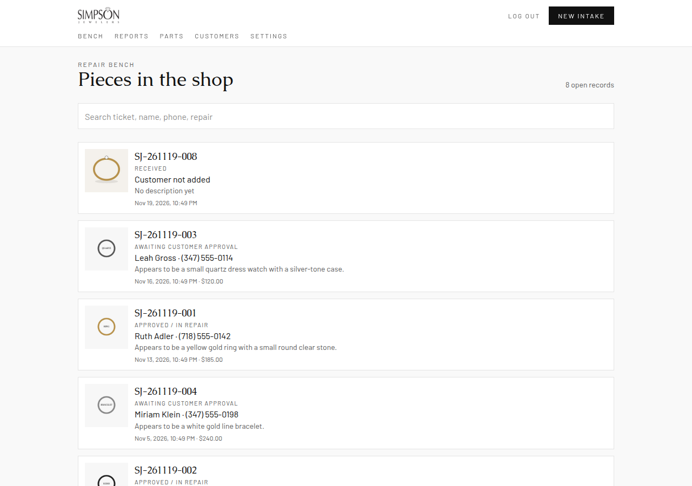
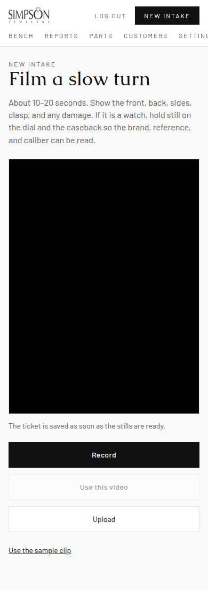
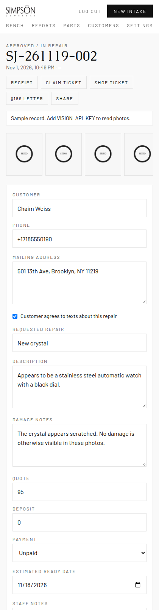
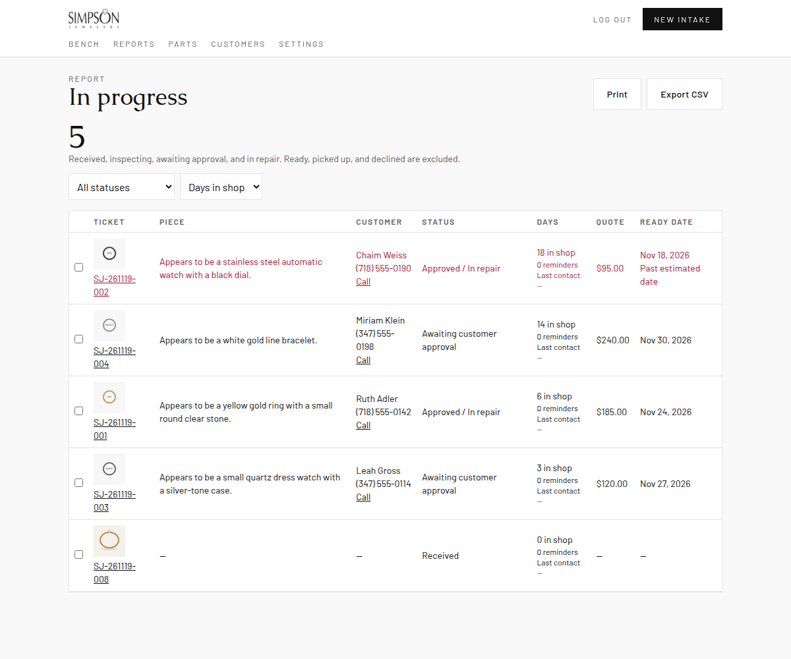
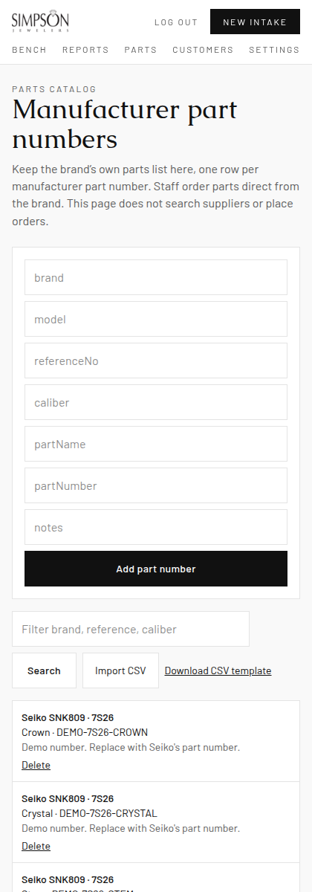
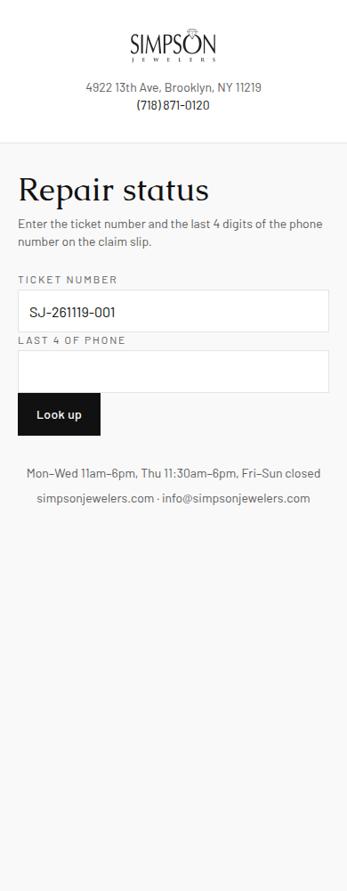
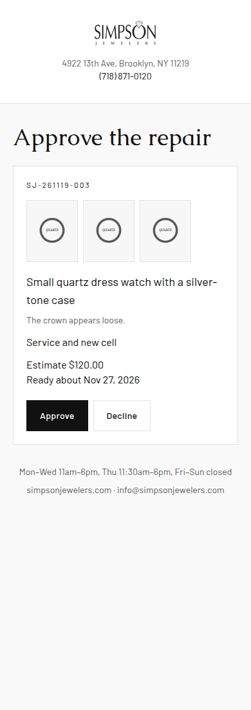
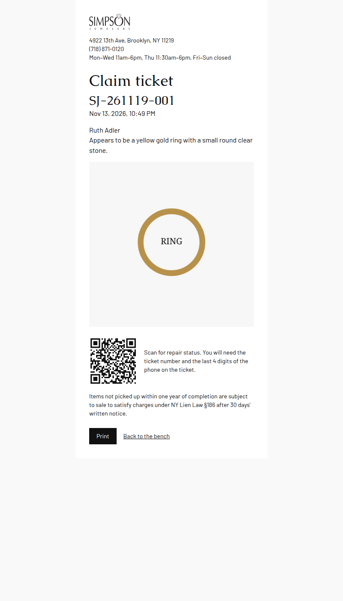
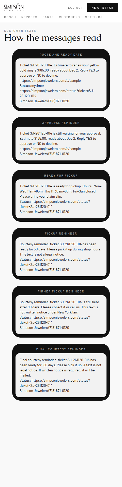

# Simpson Jewelers bench

Phone-first intake for the repair shop at 4922 13th Ave, Brooklyn. Staff film a piece, the app keeps the sharp stills, and every intake opens a ticket. Customers can check status or approve an estimate. Texts go out through Twilio, or stay in test mode when Twilio is not configured.

## Run it

Node 22 and ffmpeg are required.

```bash
npm install
npm run sample
npm run dev
```

Open http://127.0.0.1:3847 on the phone or the computer. Add to the home screen from the browser menu. The service worker and manifest make it installable.

`npm run seed` wipes the local database and loads sample tickets, including a Seiko with demo part numbers. Do not run that against a shop database you need to keep.

## Environment

Copy `.env.example` to `.env.local`.

| Variable | Purpose |
| --- | --- |
| `VISION_API_KEY` | Key for an OpenAI-compatible vision API. `OPENAI_API_KEY` is also read. |
| `VISION_BASE_URL` | Defaults to `https://api.openai.com/v1`. |
| `VISION_MODEL` | Defaults to `gpt-4o-mini`. |
| `TWILIO_ACCOUNT_SID` | Twilio account. All three Twilio variables are required for live texts. |
| `TWILIO_AUTH_TOKEN` | Used to send SMS and to validate webhook signatures. |
| `TWILIO_FROM_NUMBER` | The shop's Twilio number, in E.164. |
| `PUBLIC_BASE_URL` | Public https origin, no trailing slash. On Render, leave blank to use `RENDER_EXTERNAL_URL`. |
| `DATA_DIR` | Where the SQLite file and photos live. Defaults to `./data`. |
| `STAFF_PASSWORD` | Password for the bench. Required in production. Customer status and approval links stay open. |
| `SEED_DEMO` | `true` loads sample tickets only when the database is empty. It does not wipe a bench that already has tickets. |

If `VISION_API_KEY` is missing, photos and the ticket still save. The ticket says notes were not written.

If any Twilio variable is missing, the app is in test mode. Staff still preview the exact text and confirm it. The timeline records it as **not sent (test mode)**. Nothing is sent and there is no error.

## What staff do

1. New intake. Record or upload a slow turn, about 10–20 seconds. iPhone MOV/HEVC and Android MP4 are read with ffmpeg. For a watch, hold the dial and the caseback steady.
2. The ticket number is created as soon as the stills are saved. About 6–10 sharp, distinct frames are kept. Blurry and near-duplicate frames are dropped.
3. Description and damage notes can be edited. Wording from the model uses “appears”.
4. Add the customer, phone, mailing address, repair, and whether they agree to texts.
5. After inspection, enter the price and ready date, preview the quote, and confirm the send. Status becomes Awaiting customer approval.
6. The customer can reply YES or NO, or use the link in the text. Staff can also mark approved or declined.
7. When the piece is ready, preview the pickup text and confirm. Status becomes Ready for pickup.

Internal notes are timestamped and stay off receipts, claim tickets, and the customer status page. The author field is a name until logins exist.

## Watch parts

If the photos look like a watch, the reading fills brand, model, reference, case size, case material, dial, movement, and caliber, with a confidence level. Staff confirm or edit. The serial number is typed by hand and is not taken from the model.

Parts are a reference list of part names and manufacturer part numbers for that brand and model or reference. Maintain them under Parts, including a CSV import:

```csv
brand,model,reference,caliber,part_name,part_number,notes
```

When the catalog has rows for that watch, those rows are what the ticket shows. AI part numbers appear only if the catalog has nothing for that model, and they are labeled unverified. Add a row to the repair ticket with quantity and cost. The shop orders parts from the brand. This app does not search suppliers or place orders.

## Reports

- In progress: Received, Inspecting, Awaiting customer approval, Approved / In repair. Ready, picked up, and declined are excluded. Past the estimated ready date is shown in red.
- Awaiting approval: quote, date quoted, days waiting, follow-ups, last contact. Reminder text, call link with an outcome log, and manual approve or decline. Several rows can be texted after one confirmation.
- Not picked up: Ready for pickup for a chosen number of days, default 30.
- Abandoned / at risk: approaching one year, eligible for a §186 notice, notice mailed, eligible for sale.
- Courtesy queue: pickup reminders staff approve before they go out.

Reports print and export CSV.

## Customers

`/status` asks for the ticket number and the last 4 digits of the phone. It shows status, ready date, quote, balance, and the shop. It does not show notes, serials, or other customers. Lookups are limited per IP.

The claim-ticket QR opens that page with the ticket filled in.

Quote texts include a one-tap approval link.

## New York lien practice

Defaults follow NY Lien Law §186 for watch, clock, and jewelry repair: the account unpaid for one year after the work is complete, then 30 days' written notice, then a sale. Friendly SMS reminders default to 30, 60, 90, and 180 days. Those texts say they are not legal notice.

At one year the ticket is flagged **Eligible for lien notice**. Print the letter, mail it, and log the mailing date and certified-mail tracking number. Thirty days after that logged date, with the bill unpaid, the ticket is **Eligible for sale**. Record the sale price, expenses, and the surplus owed to the owner.

The claim ticket says: “Items not picked up within one year of completion are subject to sale to satisfy charges under NY Lien Law §186 after 30 days' written notice.”

This is not legal advice. Have an attorney review the letter, the timing, and the mailing rules before the shop relies on them. The statute is at https://legislation.nysenate.gov/pdf/laws/LIE186/. If the owner or the address is unknown, §186 allows posting in two public places in the city instead of mailing. A text does not replace that notice. The general lien sale procedure in Lien Law §201 and §202 is a separate route and is not automated here.

## Twilio

In the Twilio console, open the phone number used as `TWILIO_FROM_NUMBER`.

- A message comes in: `https://YOUR_DOMAIN/api/twilio/inbound` method POST
- Status callback is attached by the app when `PUBLIC_BASE_URL` is a public https origin: `https://YOUR_DOMAIN/api/twilio/status`

`PUBLIC_BASE_URL` must be exactly the URL Twilio calls, or signature checks fail. US long codes need A2P 10DLC registration before carriers deliver texts. The app records consent with a checkbox before a send.

## Staff login

Set `STAFF_PASSWORD` before the shop uses a public URL. Every bench page and staff API then asks for that password. These stay open without it:

- `/status` and `POST /api/status/lookup`
- `/a/…` approval links and `POST /api/approve`
- `POST /api/twilio/inbound` and `POST /api/twilio/status`

Local development leaves the bench unlocked when `STAFF_PASSWORD` is empty. Production does not.

## Free phone demo on Render

`render.demo.yaml` is a second Blueprint for Render’s free web service. It has no disk. Photos and the database sit on the instance disk, which is wiped when the service restarts or wakes from sleep (about 15 minutes of no traffic). `DEMO_MODE=true` reseeds the sample tickets on every boot and the app shows a “Demo mode, data resets” banner. Set `STAFF_PASSWORD` when Render asks. Leave Twilio, vision, and SMTP blank to stay in test mode.

This Origin git remote cannot be cloned by Render. Render deploys from GitHub, GitLab, or Bitbucket. Push this project to one of those, then in Render choose **New → Blueprint** and point it at `render.demo.yaml`.

After it is live, open the `onrender.com` URL in Safari or Chrome and use **Add to Home Screen**. The manifest, 192 and 512 icons, and Apple touch icon are included. Video uses the camera (`getUserMedia`) and an iPhone-friendly **Camera video** button (`capture=environment`). Photos use **Snap photo** and **Camera photo**.

## Deploy on Render

`render.yaml` is a Blueprint for one Docker web service and a 10 GB disk mounted at `/data`. Photos and `bench.db` live on that disk. The disk keeps the service on a single instance, and deploys restart it briefly. ffmpeg is installed in the image. A free Render web service cannot hold a disk, so the plan is `starter`.

1. Push this repository to the Git host Render can read.
2. In the Render Dashboard, choose **New** → **Blueprint**.
3. Select the repository. Render reads `render.yaml`.
4. Apply the Blueprint. When it asks for values marked secret, enter:
   - `STAFF_PASSWORD` — a password the counter staff will type
   - `VISION_API_KEY` — optional; leave blank and notes stay manual
   - `TWILIO_ACCOUNT_SID`, `TWILIO_AUTH_TOKEN`, `TWILIO_FROM_NUMBER` — optional; leave blank for test mode
   - `PUBLIC_BASE_URL` — optional; leave blank on the first deploy
5. Wait until the service is live. Copy its `https://….onrender.com` URL.
6. If you use a custom domain, set `PUBLIC_BASE_URL` to that origin with no trailing slash and redeploy. Otherwise text links use Render’s `RENDER_EXTERNAL_URL`.
7. In Twilio, on the same number as `TWILIO_FROM_NUMBER`, set **A message comes in** to `https://YOUR_DOMAIN/api/twilio/inbound` (HTTP POST).
8. Open the service URL on a phone, sign in, and record a test piece.
9. To load the sample tickets once, set `SEED_DEMO` to `true` and redeploy while the disk is still empty. Set it back to `false` afterward. `npm run seed` on a computer wipes that computer’s database; the server flag does not.

The service listens on `0.0.0.0` and Render’s `PORT`. Health checks use `/status`.

To run the same image elsewhere:

```bash
docker build -t simpson-bench .
docker run -p 3847:3847 -v simpson-data:/data \
  -e DATA_DIR=/data \
  -e STAFF_PASSWORD=choose-a-password \
  -e PUBLIC_BASE_URL=https://bench.example.com \
  simpson-bench
```

Brand name, address, phone, hours, and colors live in `lib/brand.ts`.

## Screens





















## Tests

```bash
npm test
```
